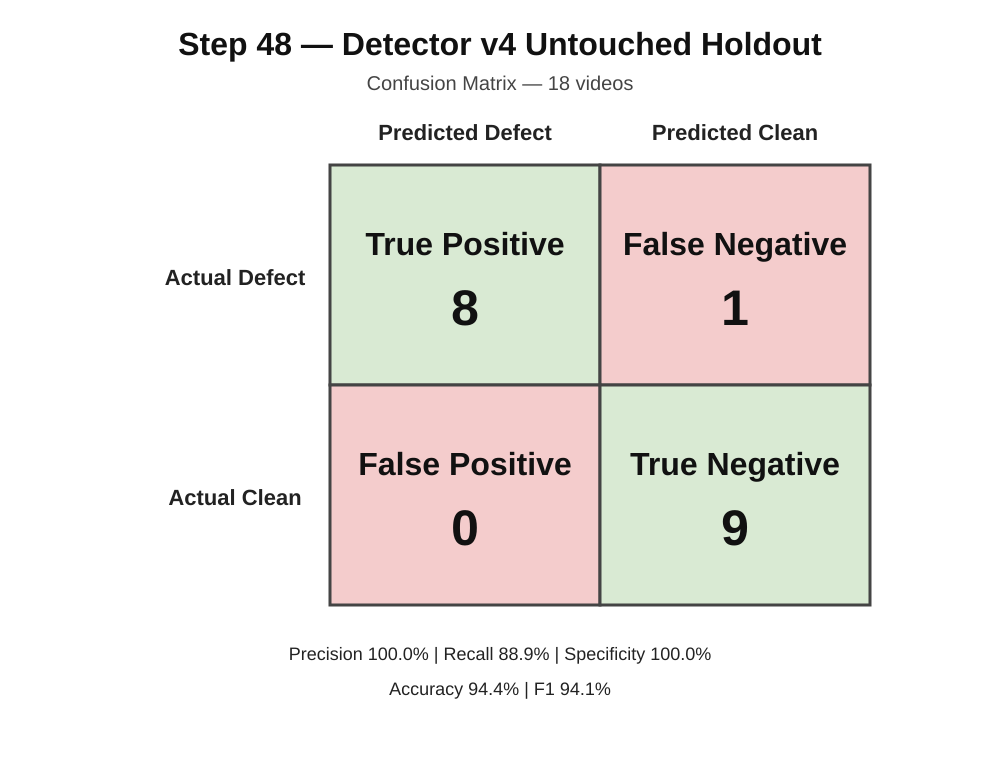

# Step 48 — Brand-New Untouched External Detector v4 Holdout

## Status

**COMPLETE — ONE-SHOT UNTOUCHED HOLDOUT EVALUATION**

Detector profile:

`detector_v4_candidate/1.0`

Frozen worker commit:

`7607014dd09ef0caea49439964af8785c913d577`

Holdout manifest SHA-256:

`EE5319F280D162059E91842317509810793AA100272AB1D8C57C93CCACEEBE88`

Pre-evaluation contract SHA-256:

`5264016487FEE043F2D81CB6A9F3B0ED150EBAA507DC608D5B90FF361B1A170A`

---

## Objective

Step 48 measures Detector v4 on a completely new external holdout that was frozen before any RentReady Vision processing was performed.

The purpose is to obtain a defensible one-shot estimate of Detector v4 performance on videos that were not used to develop, tune, debug, or select the detector.

No detector thresholds, prompts, frame-selection behavior, specialist logic, or labels were changed after the holdout was frozen.

---

## Holdout

Total videos: **18**

- Actual clean: **9**
- Actual defect: **9**

All 18 videos were processed exactly once under the frozen Step 48 protocol.

---

## Detector v4 decision rule

Detector v4 combines three frozen detector paths:

1. `v3_compatible_base_positive`
2. `arm_a_severe_damage_positive`
3. `arm_b1_electrical_flicker_positive`

Overall decision:

`predicted_positive = v3 OR Arm A OR Arm B1`

---

## Final Results

| Metric | Result |
|---|---:|
| Videos | 18 |
| True Positive | 8 |
| True Negative | 9 |
| False Positive | 0 |
| False Negative | 1 |
| Precision | **100.0%** |
| Recall | **88.9%** |
| Specificity | **100.0%** |
| Accuracy | **94.4%** |
| F1 | **94.1%** |

Detector v4 correctly classified **17 of 18** untouched holdout videos.

---

## Confusion Matrix

| | Predicted Defect | Predicted Clean |
|---|---:|---:|
| **Actual Defect** | **TP = 8** | **FN = 1** |
| **Actual Clean** | **FP = 0** | **TN = 9** |

---

## Per-video results

### Clean videos

| ID | Outcome |
|---|---|
| v4c001 | TN |
| v4c002 | TN |
| v4c003 | TN |
| v4c004 | TN |
| v4c005 | TN |
| v4c006 | TN |
| v4c007 | TN |
| v4c009 | TN |
| v4c010 | TN |

All 9 clean videos were correctly classified.

**False positives: 0**

### Positive videos

| ID | Defect class | Outcome |
|---|---|---|
| v4p002 | window_damage | TP |
| v4p003 | structural_damage | TP |
| v4p004 | surface_structural_damage | TP |
| v4p005 | structural_damage | TP |
| v4p006 | window_damage | TP |
| v4p007 | surface_damage | TP |
| v4p008 | dripping_faucet | **FN** |
| v4p009 | wall_structural_damage | TP |
| v4p010 | electrical_flicker | TP |

---

## Specialist incremental value

Step 48 produced direct evidence that both promoted Detector v4 specialists added value beyond the frozen v3-compatible base detector.

### Arm A — severe damage

`v4p002`:

- v3-compatible base: **False**
- Arm A: **True**
- Arm B1: **False**
- Detector v4: **True**

Without Arm A, this holdout defect would have been missed.

### Arm B1 — electrical flicker

`v4p010`:

- v3-compatible base: **False**
- Arm A: **False**
- Arm B1: **True**
- Detector v4: **True**

Without Arm B1, this electrical-flicker defect would have been missed.

This provides untouched-holdout evidence that both promoted specialists contribute incremental detection capability.

---

## Observed failure

The only false negative was:

`v4p008 — dripping_faucet`

Detector outputs:

- v3-compatible base: **False**
- Arm A: **False**
- Arm B1: **False**
- Detector v4: **False**

The frozen Detector v4 configuration does not contain a promoted water/leak specialist.

This failure must remain part of the Step 48 result and must not be corrected retroactively.

Any attempt to improve dripping-faucet or water/leak detection after this evaluation is **Detector v5 development** and requires a new untouched holdout for unbiased evaluation.

---

## Interpretation

The Step 48 untouched holdout produced:

- zero false positives across 9 clean videos;
- 8 detections across 9 positive videos;
- 100.0% precision;
- 88.9% recall;
- 100.0% specificity;
- 94.4% accuracy;
- 94.1% F1.

These results are substantially stronger evidence than performance measured on development or tuning data because the Step 48 videos were frozen before evaluation and were processed only once.

However, the holdout contains only 18 videos. The results should therefore be presented as an encouraging external holdout result, not as proof of production-wide accuracy across every property, camera condition, or defect category.

---

## Evaluation integrity

The Step 48 protocol prohibited:

- threshold changes;
- prompt changes;
- detector logic changes;
- model changes;
- frame-selection changes;
- removal of difficult examples;
- relabeling based on predictions;
- repeated evaluation for tuning.

All raw individual predictions are retained under:

`evaluation/step48/raw_predictions/`

Official machine-readable metrics are stored in:

`evaluation/step48/final_metrics.json`

The confusion matrix is stored in:

`evaluation/step48/confusion_matrix.svg`

---

## Conclusion

**Step 48 is complete.**

Detector v4 achieved **94.4% accuracy and 94.1% F1 on the frozen 18-video untouched external holdout**, with **zero false positives**.

The evaluation also independently demonstrated the incremental value of:

- Arm A for severe/property damage;
- Arm B1 for electrical flicker.

The principal observed remaining weakness is dripping-faucet / water-leak detection.

Further detector changes belong to Detector v5 and must not alter the frozen Step 48 evidence.
