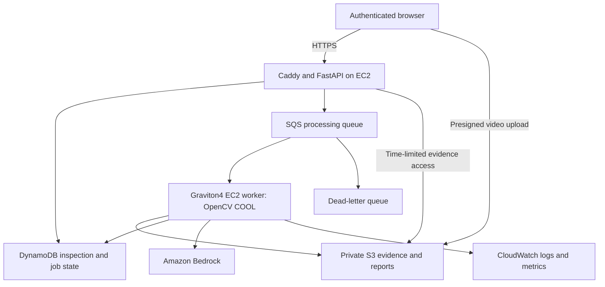

# RentReady Vision — Technical Report

**Walk through once. Know what to fix before you rent.**

**Project:** RentReady Vision, by Réunia

**Author:** Vincent Wenger

**Prepared for:** OpenCV AI Competition 2026, powered by AWS

**Report date:** October 10, 2026

**Evidence scope:** engineering records through Steps 54–56, with the frozen Step 48 Detector v4 evaluation reported separately.

This report describes the implemented prototype and recorded experiments. It was compiled from repository documentation and supplied evaluation artifacts. Report preparation did not rerun inference, audit the live deployment, or change AWS resources. Historical measurements remain tied to their original configurations and inputs.

## 1. Problem, users, and intended value

Preparing a rental property requires identifying visible work, locating it in the property, and turning observations into an actionable checklist. A phone walkthrough can capture substantial evidence, but manually reviewing a long video, finding useful frames, recording timestamps, and distinguishing repeated views of the same condition takes time. Brief events, poor lighting, camera motion, and small defects complicate that review.

RentReady Vision is designed for landlords, property managers, and people documenting a property's visible condition before rental. A user uploads a walkthrough and receives a report containing potential issues, image evidence, timestamps, review priorities, recommended actions, and a checklist. These are intended benefits; the project has not yet measured time savings or usability with a representative user population.

The system supports review of visible conditions. It cannot establish hidden damage, the cause of a stain, material composition, code compliance, habitability, or whether a tenant caused an issue. It must not substitute for a licensed inspection or determine deposit deductions automatically.

## 2. End-to-end workflow

1. The authenticated browser creates an inspection and requests a short-lived, constrained S3 upload URL.
2. The browser uploads the video directly to private S3 storage. Upload completion checks object metadata and size before processing is queued.
3. The API records inspection/job state in DynamoDB and submits a durable SQS message. The separate COOL worker starts on demand.
4. OpenCV evaluates video quality, segments scenes, removes redundant views, and selects timestamped evidence frames.
5. Detector v4 combines the compatible base detector with severe-damage and electrical-flicker specialists. Localized findings and other detector signals are retained in their appropriate evidence structures.
6. Findings are normalized, conservatively consolidated, prioritized, and rendered as a reviewable report. Supported agent operations can gather additional evidence for a candidate.
7. The user reviews images and source timestamps and maintains the preparation checklist. A completed report does not prove that an undetected condition is absent.

The report groups issues by room and uses three deterministic priority classes: **Fix before renting**, **Review recommended**, and **Cosmetic**. These are work priorities, not official safety ratings. The numeric Rental Readiness index starts at 100, subtracts 5, 1.5, and 0.2 points per issue in those respective classes, rounds half up, and clamps at zero. It is a transparent heuristic based on detected visible work; missed findings can leave the index misleadingly high. See [report design](STEP28_POLISHED_REPORT.md) and [priority rules](STEP25_SEVERITY_CLASSIFICATION.md).

## 3. OpenCV 5 perception and evidence selection

OpenCV performs substantive perception and evidence preparation before model-assisted interpretation. It also implements targeted evidence tools and the deterministic flicker specialist.

### 3.1 Frame quality and motion

The documented base pipeline samples at 1 Hz and evaluates sharpness, exposure, and camera stability. Whole-frame and 3×3 tiled variance of Laplacian help distinguish generally blurred images from frames with only a small sharp region. Brightness mean, percentiles, and clipped-pixel fractions identify dark and overexposed evidence.

Camera-motion estimation uses Shi–Tomasi corners (`goodFeaturesToTrack`), pyramidal Lucas–Kanade tracking (`calcOpticalFlowPyrLK`), and robust partial-affine estimation (`estimateAffinePartial2D` with RANSAC). Motion measurements are normalized by image diagonal and elapsed time, with a three-observation temporal median. Too few features or inliers produce unknown motion rather than an unsupported rejection.

The recorded evidence-quality score weights sharpness at 45%, exposure at 30%, and stability at 25%. Each sampled frame has an auditable assessment and selection/rejection reason.

### 3.2 Scenes, duplicates, and keyframes

Scene detection combines HSV histogram similarity, ORB descriptor matching, geometric consistency, and camera-motion evidence. Minimum-duration suppression avoids unstable boundaries; maximum-duration splits preserve coverage. Similarity to neighboring frames and the scene reference contributes to the boundary decision.

Within a scene, sharp acceptable frames are considered first. HSV and geometrically validated ORB comparisons remove redundant views, including some shifted duplicates. A short-window pass also checks adjacent scene boundaries. Adaptive selection considers sharpness, exposure, stability, visual distinctiveness, and temporal distance.

Documented defaults include duration-dependent baseline coverage, up to eight keyframes per scene, and a global cap of 120. When strict quality filtering would leave a scene empty, labeled best-available fallback evidence can preserve coverage. Such a fallback does not become high-quality evidence merely because it was retained. Processing parameters belong to a recorded run and should be verified before reproducing that run.

| OpenCV operation | Purpose | Important limitation |
| --- | --- | --- |
| Laplacian and tiled quality measures | Rank/reject blurred evidence | Sharpness does not establish defect visibility |
| Brightness statistics | Detect unsuitable exposure | A well-exposed image can still hide a small defect |
| Lucas–Kanade flow and RANSAC affine estimation | Assess camera stability | Low-texture views can make motion unknown |
| HSV histograms, ORB matching, and geometry | Segment scenes and remove redundant views | A transient event can disappear during deduplication |
| Adaptive keyframe selection | Bound model input while retaining coverage | A frame cap and sparse sampling can miss brief events |
| Interval extraction, cropping, enhancement, and other-angle search | Gather targeted supporting evidence | More images can reinforce a mistaken interpretation |

The manifest records frame assessments, scene boundaries, retained timestamps, selection scores, and reduction counts. Historical algorithm details are retained in [Development history](DEVELOPMENT_HISTORY.md); that archive's old deployment instructions are superseded by the current README and later operational records.

## 4. Detector v4 and finding representation

The evaluated profile is `detector_v4_candidate/1.0`. Its video-level positive decision is:

`v3-compatible base positive OR Arm A severe-damage positive OR Arm B1 electrical-flicker positive`

The model-assisted base uses Amazon Bedrock, with Amazon Nova 2 Lite and a conditional Claude Sonnet 4.5 path documented in the development/integration records. Full-frame and detail views support small-condition interpretation. Arm A examines selected frames for severe physical damage. Arm B1 is deterministic: its documented temporal sampling interval is 0.25 seconds, with brightness-p95 and brightness/frame-difference-ratio gates; it requires no model calls. The experimental water-motion, semantic-water, and fixture-condition specialists were not promoted into this profile. See [integration](STEP46_FINAL.md) and [live deployment](STEP47_FINAL.md).

Localized candidates include normalized room/category, a visible-condition description, a submitted-frame timestamp, confidence, and a normalized bounding box. Application validation checks coordinates and timestamp correspondence before downstream tools consume them. Repeated observations are consolidated using room/category gates, bounded temporal/spatial continuity, and visual/semantic similarity. Raw observations remain available for audit. See [structured findings](STEP17_STRUCTURED_JSON.md) and [consolidation](STEP24_ISSUE_CONSOLIDATION.md).

Not all signals are localized issue cards. Holder geometry, whole-scene severe-damage evidence, and clip-level flicker evidence can remain separately represented in `detector_signals`; fabricated bounding boxes are not added to make those signals fit a localized schema. Consequently, a positive video-level classification does not establish that the report contains every correct defect, a correct issue count, or a precise rectangle.

Step 52 subsequently bounded production Arm A requests to eight images per batch and merged results while retaining image identities and accounting for actual calls. This changes request construction relative to earlier runs; the Step 48 metrics remain measurements of the frozen Step 48 configuration. They are not a fresh evaluation of the current complete application. See [input protection](STEP52_BEDROCK_INPUT_GUARD.md).

## 5. Agentic verification and human control

The project uses bounded, policy-driven investigation. It should not be described as unrestricted autonomous model planning. Tools execute through the existing SQS/COOL worker path and retain their arguments, evidence references, runtime identity, and decisions.

| Tool | Implemented behavior |
| --- | --- |
| `inspect_interval()` | Resamples a bounded interval around a candidate; a documented live example used 2 seconds before, 3 after, and 6 fps, clipped to video boundaries |
| `crop_region()` | Converts validated normalized coordinates into a padded, aspect-preserving close-up, preserving the source image |
| `enhance_region()` | Applies explicit contrast, brightness, and sharpening controls to a copied region; labels the result as an enhanced inspection view |
| `inspect_other_angle()` | Searches nearby frames using ORB and RANSAC homographies for geometric continuity and a useful changed view; unavailable evidence remains explicit |

Original evidence and enhanced views are distinct. Enhancement can improve visibility but does not establish truth or reveal hidden information. See [interval](STEP18_AGENTIC_VISION.md), [crop](STEP19_CROP_REGION.md), [enhancement](STEP20_ENHANCE_REGION.md), and [other-angle](STEP21_OTHER_ANGLE.md) records.

The deployed Step 22 policy accepts candidate confidence above 0.85, investigates 0.50–0.85 inclusive, and rejects below 0.50 unless a safety-sensitive routing guard applies. Its investigation is bounded to temporal inspection and an optional crop, followed by reassessment or human approval. Safety-sensitive routing prevents unsupported automatic rejection; it does not diagnose a hazard. Evidence sufficiency requires more than a frame count alone. See [decision policy](STEP22_DECISION_POLICY.md).

The Step 36 measurement uses a separate frozen policy: interval inspection, then crop, other-angle evidence, and final verification only while uncertainty remains, stopping at a terminal decision. That experiment must not be conflated with the exact deployed Step 22 graph or the Step 35 ablation. Action logs retain observations, tools, confidence changes, final decisions, and human-control outcomes. See [action tracing](STEP23_AGENT_ACTION_LOG.md) and [Step 36 experiment](STEP36_AGENTIC_VERIFICATION.md).

## 6. AWS architecture and COOL deployment



The recorded deployment uses a small ARM64 EC2 API host, Caddy for HTTPS, and a separate `m8g.4xlarge` Graviton4 worker in `us-west-2`. FastAPI binds to loopback behind the proxy. The worker has no inbound security-group rules and uses AWS Systems Manager for management. This is a single-operator prototype architecture, not a demonstrated high-availability or multi-tenant service.

SQS provides durable delivery and retry/DLQ handling. DynamoDB conditional job ownership, leases, heartbeats, and guarded completion protect against stale or duplicate execution. Structured CloudWatch lifecycle records cover processing, model calls, tools, completion, and failure. See [durable worker](STEP14_PRODUCTION_WORKER.md), [hosting](STEP40_HOSTING.md), and [observability](STEP41_OBSERVABILITY.md).

The worker runs the official **Cloud Optimized OpenCV For AWS Graviton4** Marketplace runtime. Recorded runtime evidence identifies COOL 3.1, OpenCV **5.1.0-dev**, Python 3.12, and `aarch64`. The Marketplace release label and the observed imported OpenCV version are recorded separately. A local pip OpenCV installation is not COOL.

Versioned worker artifacts carry source identity and SHA-256 verification and install alongside the supplied `/opt/cool` runtime. Worker dependencies intentionally exclude a pip OpenCV wheel, which could replace or mask the authoritative COOL build. Runtime verification checks the imported `cv2` location and architecture as well as version. See [COOL launch](COOL_AWS_LAUNCH.md) and [deployment hardening](STEP38_AWS_COOL_HARDENING.md).

Step 49 adds API-triggered worker startup and a Lambda controller that reconciles every minute. Shutdown after 600 seconds idle is guarded by durable jobs, queue counts, and a busy/drain guard. Recorded live checks cover cold startup, overlapping work, and an upload arriving during shutdown. Stopping compute reduces idle worker cost but does not eliminate storage or other service charges; cold startup also adds latency. See [worker lifecycle](STEP49_ON_DEMAND_WORKER.md).

Operational additions expose measured byte/sample/frame progress, explicit waits when totals are unknown, disk-space guards, model-input batching, batch retrieval of frame URLs, and cancellation. Cancellation distinguishes request acknowledgment from completed cancellation and guards against stale publication. These controls have their own validation scope; they do not establish accuracy on large videos or acceptance of every concurrency edge case. See [progress](STEP50_REAL_PROGRESS.md), [storage safety](STEP51_STORAGE_SAFETY.md), [report batching](STEP52_REPORT_BATCH_OPTIMIZATION.md), and [cancellation](STEP53_CANCEL_INSPECTION.md).

## 7. Evaluation and measured findings

Each experiment has its own unit, configuration, and limitations. Their metrics must not be combined into a single claim about production accuracy.

### 7.1 Frozen external Detector v4 holdout — Step 48

The holdout was manually screened and frozen before RentReady processing: **18 videos, 9 positive and 9 clean**. The manifest preserves source metadata, labels, sizes, and SHA-256 hashes. This is a curated external collection, not a representative random sample of rental properties. The unit is **one video's defect/clean classification**.

| Ground truth | Predicted defect | Predicted clean |
| --- | ---: | ---: |
| Defect | 8 true positives | 1 false negative |
| Clean | 0 false positives | 9 true negatives |

| Metric | Result | Calculation |
| --- | ---: | --- |
| Accuracy | 94.4% | 17/18 |
| Precision | 100.0% | 8/(8+0) |
| Recall | 88.9% | 8/(8+1) |
| Specificity | 100.0% | 9/(9+0) |
| F1 | 94.1% | 16/(16+0+1) |

The false negative is `v4p008`, a dripping faucet. Arm A uniquely recovered `v4p002` relative to the compatible base; Arm B1 uniquely recovered `v4p010`, electrical flicker. These are concrete incremental contributions on this holdout.

The pre-evaluation protocol prohibited changing prompts, thresholds, models, selection, labels, or membership after observing predictions. The frozen worker commit is `7607014dd09ef0caea49439964af8785c913d577`; the holdout manifest SHA-256 is `EE5319F280D162059E91842317509810793AA100272AB1D8C57C93CCACEEBE88`.

Zero false positives among nine clean videos does not establish a zero population false-positive rate. The small, curated sample does not establish accuracy across defect categories, properties, camera conditions, issue localization, or later product changes. No current end-to-end product accuracy is inferred from it. See [protocol](STEP48_PROTOCOL.md), [results](STEP48_RESULTS.md), [machine-readable metrics](evaluation/step48/final_metrics.json), and [holdout manifest](evaluation/external_v4_holdout/manifest.json).

### 7.2 Candidate-level agent challenge — Step 36

The separate frozen challenge contains two ambiguous candidates: one real displaced trim condition and one removable surface look-alike on an undamaged surface. Both entered investigation at confidence 0.85.

| Measure | Recorded result |
| --- | ---: |
| Strict classification accuracy before investigation | 0/2 |
| Strict classification accuracy after investigation | 1/2 (50%) |
| Ambiguous candidates resolved to a terminal classification | 2/2 |
| Real positive recovered | 1/1 |
| Negative candidate correctly rejected | 0/1 |
| Evidence-tool calls per investigated candidate | 1 |

Initial unresolved decisions count as incorrect in this strict binary metric; 0/2 does not mean two confident incorrect initial classifications. Interval evidence recovered the real condition but reinforced the false surface claim. The negative candidate's confidence rose to 1.00, triggering early stopping. Neither candidate exercised the later crop/other-angle/final-verification stages in this challenge.

Temporal persistence confirms that an appearance persists; it does not establish its physical nature. The two-case result demonstrates a useful recovery and an important failure, not a robust population estimate or reliable false-positive suppression. See [frozen challenge summary](evaluation/step36/challenge_final_v1/summary.md).

### 7.3 Same-hardware stock OpenCV versus COOL — Step 13

The September 6 experiment used the same EBS-resident input, code, parameters, Graviton4 instance, Python 3.12, and NumPy baseline. Each environment had one excluded warm-up and five measured fresh-process executions, interleaved to reduce execution-order bias.

| Measure | Stock OpenCV 5.0.0 | COOL OpenCV 5.1.0-dev |
| --- | ---: | ---: |
| Mean OpenCV workload time | 161.719 s | 150.696 s |
| Median time | 161.919 s | 150.414 s |
| Mean sampled-frame throughput | 6.511 frames/s | 6.988 frames/s |
| Mean peak process memory | 268.087 MiB | 278.726 MiB |
| Retained evidence / scenes | 74 / 54 | 74 / 54 |

Mean workload time decreased **6.817%**, with throughput increasing **7.324%**. Measured runs preserved scene boundaries, frame identities, counts, and selection scores. The experiment excludes S3, DynamoDB, Bedrock, issue detection, network latency, and runtime-metadata lookup. It is a historical OpenCV-workload benchmark on one input, not a 6.817% end-to-end website speedup; COOL also used more peak memory in this measurement.

At the benchmark's recorded historical EC2 rate, estimated active compute cost decreased 6.814%. This excludes storage, idle/startup time, API hosting, model calls, and other charges, and is not a current price quote or total inspection cost. See [methodology](STEP13_BENCHMARK.md) and [benchmark JSON](evaluation/step13/benchmark_results.json).

### 7.4 Development ablation and historical failures

The archived Step 35 measurements describe 21 development clips. OpenCV selection reduced unique source frames from 122 to 67 and estimated AI cost from $2.77 to $1.49, with average processing time decreasing from 24.15 to 14.08 seconds. Owner-reviewed interval recall remained 11.1%; issue precision changed from 20.0% to 33.3%. These are historical development measurements, and cost estimates are not invoices.

The agentic arm recorded 20 tool calls and 22.2% interval recall, but owner review attributed confirmed improvements to initial detection rather than reinspection recovery and identified two reinspection false positives. The Step 35 protocol document still contains pending-state wording; these summary values are explicitly attributed to the archived development record, not independently re-audited raw Step 35 runs. See [ablation design](STEP35_OPENCV_CONTRIBUTION.md) and [archived measurements](DEVELOPMENT_HISTORY.md).

Earlier failures are retained: the original Step 34 property-held-out configuration detected none of eight positive clips, and Step 44 frozen v3 recorded TP=1, TN=7, FP=1, FN=5. Those sets and configurations differ from Step 48, so they cannot establish a controlled v3-to-v4 performance uplift. Consumed holdouts used for subsequent research are development data thereafter. See [failure analysis](STEP37_FAILURE_CASES.md) and [v3 external evaluation](STEP44_FINAL.md).

## 8. Software validation and reproducibility

The Step 56 record documents Windows/Python 3.12.10 validation from the locked application dependencies, with separate browser tooling and dummy AWS credentials for offline tests:

```bash
python -B -m pytest -q -p no:cacheprovider --ignore=tests/test_step34d_freeze.py --ignore=tests/test_step35_measurement.py
```

The recorded result is **727 passed, 1 skipped**, with one non-failing deprecation warning. Exactly the two named historical evaluation modules were excluded. A focused video-processing/report-browser/overlay run recorded **20 passed**. These are regression results for the included suite, not an unconditional all-tests pass or proof of model correctness.

The synthetic local smoke test created an eight-second, 96-frame video and produced eight samples, one scene, and three retained frames without AWS or model calls. It proves local execution, not repeated-run determinism or a COOL/AWS end-to-end reproduction. See [Step 56 verification](STEP56_JUDGE_RELEASE_CHECKLIST.md).

Step 54 recorded successful deployment and public health/frontend checks, with Chromium fixture tests for responsive rectangles and oversized-box suppression. It explicitly did not perform a new authenticated end-to-end report-browser check after the final quality fix. Some rectangles were inaccurate during visual review despite being below the size filter. See [Step 54 validation](STEP54_FINAL.md).

To reproduce local OpenCV processing, use a clean Python 3.12 environment and a synthetic or consented video, following the [README](README.md). This produces local evidence, not the complete authenticated Bedrock report. The cloud path requires authorized AWS/model access and the official COOL environment. Application requirements are hash-locked; `requirements-cool.txt` pins direct dependencies but does not constitute a fully locked transitive worker environment. Bit-for-bit worker reproducibility and broader repeat-run determinism remain unestablished. Future Terraform changes also require reconciliation of the documented manually created IAM policies before apply.

## 9. Security, privacy, and data retention

The recorded Step 40 security verification covers the single-operator deployment:

- HTTPS, authenticated inspection operations, constrained short-lived SigV4 uploads, and conditional writes preventing overwrite of an existing original.
- Private S3 with Public Access Block and ACLs disabled; encryption for stored media, DynamoDB, queues, and instance disks.
- Separate API and worker IAM roles, temporary instance credentials, and a managed SSM SecureString for the operator token.
- Runtime secret retrieval, fail-closed authentication/configuration behavior, restricted production documentation endpoints, and security headers.

**One shared operator token grants access to all inspections in this deployment.** Individual user accounts and tenant isolation are not implemented. The public website URL alone does not grant access, but sharing the operator token would expose the deployment's inspection collection. Judge/tester access needs a separately verified arrangement. The security record is not an account-wide audit or penetration test. See [security controls](STEP40_SECURITY.md).

New artifacts use `rentready/inspections/{inspection_id}/` with separate original, frames, crops, evidence, and reports folders. Legacy records retain their earlier keys. Original videos have a default 30-day tagged lifecycle rule; noncurrent original versions expire after another configured noncurrent period, and incomplete multipart uploads are cleaned after seven days. **Frames, crops, evidence, manifests, and reports have no automatic expiry under these rules.** Lifecycle deletion is asynchronous, and versioned originals can persist beyond day 30. After original expiry, retained evidence can remain readable while video-dependent reinspection is unavailable. See [storage and retention](STEP39_S3_STORAGE.md).

Walkthroughs can contain people, documents, and other sensitive details. Appropriate permission, careful recording, and review of published examples are necessary; automatic face/document redaction is not established by the supplied evidence. Step 56 removed tracked bytecode from the current tree and performed scoped text/history/screenshot checks, but the recorded checklist still identifies broader artifact/history review and judge-access validation as pending. Those checks do not certify all historical binaries or personal data as safe for public release. Frozen private evidence should be preserved separately from sanitized publication examples.

## 10. Responsible AI safeguards and remaining limitations

Implemented safeguards include versioned language rules, explicit human-review messaging, bounded evidence gathering, auditable decisions, immutable originals, separately labeled enhancements, and deterministic priority classification. Language checks operate at prompt, normalization/persistence, agent-summary, and API boundaries. They replace unsupported diagnosis with visible-condition descriptions and recommendations for qualified review. See [responsible language](STEP27_RESPONSIBLE_LANGUAGE.md).

The UI displays Low/Medium/High confidence while preserving internal numeric scores and traces. These labels do not calibrate the model's probability of correctness and do not change the separate investigation thresholds. The falsely accepted Step 36 candidate demonstrates why high confidence is not proof. See [confidence presentation](STEP26_CONFIDENCE.md).

Step 54 displays AI-estimated red rectangles, hides boxes covering at least 80% of an image, preserves originals, and warns users to verify visually. The size filter does not validate spatial correctness. A video classification, issue description, priority, confidence label, and rectangle must each be assessed on their own merits.

| Remaining limitation | Evidence or implication |
| --- | --- |
| Brief leaks and other transient events | Sparse sampling/deduplication lost historical drip evidence; Step 48 missed a dripping faucet |
| Candidate-triggered reinspection | No candidate can mean no targeted recovery attempt |
| Surface look-alikes | Temporal persistence reinforced a false finding in the frozen agent challenge |
| Small or poorly localized defects | Earlier defect-visible frames produced no candidate; some report rectangles were inaccurate |
| Model variance and later production changes | Historical configuration metrics do not establish today's whole-product accuracy |
| Small curated evaluation samples | No representative category/property coverage or broad reliability estimate |
| Single-operator access model | Shared token access lacks user/tenant isolation |
| Retained derived evidence | Original-video expiry does not expire reports and image evidence |

The supplied records do not establish feedback-driven detector learning, autonomous retraining, demographic/subgroup evaluation, or automatic privacy redaction. Checklist edits are workflow controls and must not be described as labeled detector feedback.

Practical future work is to collect explicit finding-level corrections and missed-finding annotations for developer review, expand consented evaluation coverage, improve transient-water detection, test deeper verification for surface look-alikes, and implement user isolation and deliberate evidence-retention controls. These are proposed improvements, not current features. Any detector improvement informed by Step 48 becomes subsequent development and needs a new untouched evaluation before an unbiased accuracy claim.

## 11. Technical conclusion

RentReady Vision implements an evidence-centered rental-inspection prototype: OpenCV 5 prepares and investigates video evidence, official COOL runs that workload on AWS Graviton4, Bedrock assists condition interpretation, and the application retains reviewable reports and action traces. The strongest frozen v4 result is 17/18 correct video classifications on a small curated external holdout. Separate experiments demonstrate equivalent selected evidence under COOL and an agent recovery alongside a documented false confirmation. Human review remains essential, and current product reliability must not be inferred from any single historical metric.

## Evidence index

| Subject | Authoritative project records |
| --- | --- |
| Current workflow and setup | [README](README.md) |
| OpenCV and development measurements | [Development history](DEVELOPMENT_HISTORY.md), [Step 35](STEP35_OPENCV_CONTRIBUTION.md) |
| COOL identity, benchmark, and deployment | [Launch runbook](COOL_AWS_LAUNCH.md), [Step 12](STEP12_COOL_VALIDATION.md), [Step 13](STEP13_BENCHMARK.md), [Step 38](STEP38_AWS_COOL_HARDENING.md) |
| Detector profile and deployment | [Step 46](STEP46_FINAL.md), [Step 47](STEP47_FINAL.md) |
| Frozen external evaluation | [Step 48 protocol](STEP48_PROTOCOL.md), [Step 48 results](STEP48_RESULTS.md), [metrics JSON](evaluation/step48/final_metrics.json) |
| Agent policy and experiment | [Step 22](STEP22_DECISION_POLICY.md), [Step 36](STEP36_AGENTIC_VERIFICATION.md), [challenge summary](evaluation/step36/challenge_final_v1/summary.md) |
| Failures and localization | [Step 37](STEP37_FAILURE_CASES.md), [Step 54](STEP54_FINAL.md) |
| Security and storage | [Step 40](STEP40_SECURITY.md), [Step 39](STEP39_S3_STORAGE.md) |
| Regression and release-review scope | [Step 56 checklist](STEP56_JUDGE_RELEASE_CHECKLIST.md) |

All relative links assume this file is installed as `TECHNICAL_REPORT.md` at the repository root. Evaluation references preserve their original experimental scope; source and private media access remain subject to the project's release review and the underlying media permissions.
